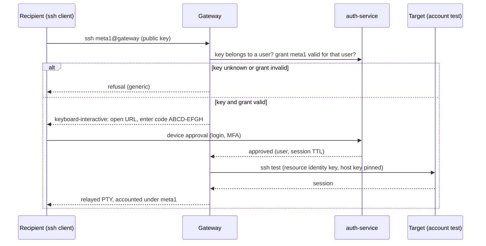

> Living document: update the status columns, the decision log and the change
> log in the same commit as the work they describe.
> Status legend: ✅ done · 🟡 in progress · ⬜ planned · 🚫 dropped · ❓ blocked on a decision.
>
> **Consolidated design:** the 2026-11-15 decisions move ownership, grants and
> accounting into the generic resource model, keep the gateway as a system
> application, and reject Warpgate as a drop-in (its authorization is its own
> role/target database). See
> [8. Resource sharing — consolidated design](./8.resource-sharing-final-design)
> and the Warpgate spike in section 8 of that document.
>
> **Implementation is external:** the gateway is a separate repository and
> Docker image. Its precise contract and implementation prompt live in
> [9. SSH gateway — external contract](./9.ssh-gateway-external-spec). The
> auth-service lots only implement the auth-service side and consume the image
> through the `ssh` Compose profile.
>
> Evidence base: `REPORT.md` in `/tmp/kilo/openpubkey-analysis` (OpenPubkey and
> OPKSSH analysis, live validation on `nuk.local`, §9). The facts it establishes
> are restated below. Parent plans: `5.resource-sharing-plan.md` (resource model)
> and `6.litellm-acl-plan.md` (entitlement pattern reused here).

## 1. Goal and scope

A resource owner declares an internal server and one target account on it
(`test@server`). The owner grants another auth-service user access to that
account. The recipient reaches the account through the gateway, using a
meta-user name that identifies the share.

The target server is never asked to know the recipient. It trusts exactly one
key per resource: the gateway's identity key for that resource, placed in the
target account's `authorized_keys` once.

**In scope**

- Declaration of an SSH resource and its target account by an owner.
- Ownership validation by the gateway, based on a successful login with the
  resource identity key.
- Per-share meta-user names, resolved by the gateway after authentication.
- Recipient authentication at the gateway: registered SSH key plus OIDC device
  approval.
- Session relay, accounting per share, and revocation that ends live sessions.

**Out of scope**

- SSH certificates (issuance, uPKI signing, `TrustedUserCAKeys`). Dropped for
  this plan.
- OpenPubkey and OPKSSH (server-side and client-side). Dropped; see §3.
- `ProxyJump` / `ProxyCommand` relays. Not compatible with the model; see §3.
- Files (`file://`), HTTP(S) endpoints and machine identities for automation.

## 2. Validated facts

| Fact | Source |
|---|---|
| OpenSSH 9.6p1 on `nuk.local` accepts key-only login for the test account when the public key is in its `authorized_keys`. | REPORT §9.2 row 2 |
| `test@nuk.local` gives a normal shell with the owner's ED25519 agent key. | REPORT §9.1 |
| Original `authorized_keys` was restored byte-identical; no live sshd configuration was changed. | REPORT §9.3 |
| Passwordless `sudo` is not available to `test`. Any change under `/etc/ssh` needs an administrator. | REPORT §9.1 row 6 |
| `ProxyJump` and `ProxyCommand ssh -W` are TCP relays: the final SSH authentication happens end to end with the target. | Protocol behaviour; checked against §3 of this plan |
| The `from=` and `restrict` options in `authorized_keys` are standard OpenSSH options. Their effect on this host has **not** been tested. | Unverified; spike S-3 |

## 3. Decisions

| ID | Decision | Rationale |
|---|---|---|
| D-SSH-1 | The gateway terminates every SSH session. Clients connect to the gateway with `ssh <meta-user>@<gateway>`. | Only a terminating gateway can choose the target account after authentication and account every session. |
| D-SSH-2 | No `ProxyJump` or `ProxyCommand` relay for access. Client configuration uses `HostName` and `User` aliases only. | A relay makes the target authenticate the client end to end, which requires the client's key on the target. |
| D-SSH-3 | One identity key pair per declared resource (`resource_identity`), generated by auth-service at declaration. | A key shared across declarations would let a second declarer be validated by a key already installed by the first. |
| D-SSH-4 | The private identity key is encrypted at rest with an envelope key held outside the database. Only the gateway decrypts it. | Limits the impact of a database leak. Key custody is an open question (§9). |
| D-SSH-5 | Ownership is validated by the gateway logging in to `<account>@<host>` with the resource identity key. Success sets the resource to `validated`. | The owner must have write access to the account to install the key, which is the control we need to prove. This supersedes the host-key-signature proposal in REPORT §6.4 (SSH-HOST). |
| D-SSH-6 | A resource targets exactly one account. Several accounts on one host are several resources. | Keeps authorization, accounting and revocation per account. |
| D-SSH-7 | Each share has a meta-user name: 8 characters, base32 lowercase, from `crypto.randomBytes`, unique in the database. It identifies a share; it is not a credential. | Two shares of the same `host:account` remain distinct for accounting. |
| D-SSH-8 | Recipient authentication is a registered SSH public key plus OIDC device approval (RFC 8628) through keyboard-interactive. | The key identifies the client device; the device approval proves a person authenticated and allows MFA and revocation. |
| D-SSH-9 | Device approval gives a session with a bounded lifetime (default 8 h, to be confirmed). Revocation ends live sessions. | Bounded trust and an explicit kill path. |
| D-SSH-10 | Unknown user, unknown meta-user, missing grant and failed approval all return the same refusal. | Prevents enumeration of meta-user names and of owners. |
| D-SSH-11 | The target server receives one line in `authorized_keys`: `restrict,pty,from="<gateway-ip>" ssh-ed25519 AAAA… ssh-identity-<resource-id>`. Agent and port forwarding are disabled. | Minimal server-side change; no root beyond the target account. |
| D-SSH-12 | The target host key is pinned in the resource record and verified by the gateway on every connection. The fingerprint is shown by the owner from the server itself during declaration. | Prevents a gateway-to-target man-in-the-middle after declaration. |
| D-SSH-13 | The SSH gateway is a separate deployable, never part of the auth-service process. It calls the authorize API of auth-service for every decision (D38 in `5.resource-sharing-plan.md`). | Isolates long-lived sessions and identity keys from the API process and keeps the decision plane in one place. |

Superseded: the OpenPubkey/OPKSSH recommendation of REPORT §7.4 and the
SSH certificate path of options A and E are not part of this plan.

## 4. Data model

New tables live in a dedicated schema file (`src/db/gateway-schema.ts`), since
`src/db/schema.ts` is already 999 lines (hard limit 1000). Column names follow
the project's `snake_case` rule.

| Table | Key columns | Notes |
|---|---|---|
| `ssh_resource` | `id`, `owner_user_id`, `name`, `host`, `port`, `target_account`, `host_key_fingerprint`, `status` (`pending` / `validated` / `disabled`), `created_at`, `validated_at` | Unique `(host, port, target_account, owner_user_id)`. Name unique per owner. |
| `ssh_resource_identity` | `resource_id` (PK, FK), `public_key`, `private_key_encrypted`, `key_version`, `created_at`, `rotated_at` | One row per resource (D-SSH-3). Rotation creates a new `key_version`. |
| `ssh_share_grant` | `id`, `meta_user` (unique, 8 chars), `resource_id`, `recipient_user_id`, `expires_at`, `revoked_at`, `created_by` | Owner-issued. A grant is valid when not revoked and not expired. |
| `ssh_recipient_key` | `id`, `user_id`, `public_key`, `fingerprint` (unique), `label`, `created_at`, `revoked_at` | Keys registered by the recipient in their profile (D-SSH-8). |
| `ssh_session` | `id`, `grant_id`, `user_id`, `started_at`, `ended_at`, `bytes_in`, `bytes_out`, `end_reason` | Accounting per share (§7). |

## 5. Flows

### 5.1 Owner declares a resource

1. Owner calls `POST /ssh/resources` (name, host, port, target account).
2. auth-service creates the resource in `pending`, generates the identity key
   pair, encrypts the private key, and returns the single `authorized_keys`
   line for the target account.
3. The owner displays the target host key fingerprint on the server
   (`ssh-keygen -lf /etc/ssh/ssh_host_ed25519_key.pub`) and confirms it in the
   same request. The gateway stores it as `host_key_fingerprint`.
4. The owner appends the line to `~<account>/.ssh/authorized_keys` on the
   server.
5. The owner triggers validation. The gateway logs in with the identity key,
   checks the host key against the stored fingerprint, runs a fixed command,
   and closes the session. Success sets `validated`; failure leaves `pending`
   with the reason.

### 5.2 Owner shares a resource

1. Owner calls `POST /ssh/resources/:id/grants` with recipient user and
   expiry. Only `validated` resources can be shared.
2. auth-service generates a unique `meta_user` and creates `ssh_share_grant`.
3. The owner can revoke with `DELETE /ssh/grants/:id`. Revocation is effective
   for new sessions immediately and ends live sessions (§5.4).

### 5.3 Recipient connects

Rules:

- The gateway resolves `meta_user` only after the key is matched to a user
  (D-SSH-10).
- The approved session has a bounded lifetime (D-SSH-9). A new connection
  requires a new approval unless a live approval is still valid.
- The meta-user name never selects an account on the target. The account comes
  from `ssh_resource.target_account`.

### 5.4 Revocation

- Grant revoked: the gateway closes the session with `end_reason = revoked` and
  refuses new connections for `meta_user`.
- Owner disables the resource: all grants on it stop; live sessions end.
- Recipient key revoked: the key is refused on the next connection; live
  sessions for that key end.

## 6. Security requirements

- The gateway runs in its own container. Its only outbound network route is
  TCP/22 to declared targets, plus auth-service.
- The gateway holds the identity keys; no operator shell on the gateway. Access
  to key material is logged.
- Target `authorized_keys` entries always carry `restrict,pty,from=…`. Forwarding
  options are added only if a future grant explicitly requires them.
- Device approval codes are single-use and expire in 10 minutes. Rate limits
  apply per source address and per user (reuse the existing auth rate-limit
  buckets pattern in `src/server.ts`).
- Logs contain fingerprints, meta-user names, user IDs, timestamps and
  `end_reason`. They never contain private keys, device codes or terminal
  content.
- Terminal content recording is out of scope for the first delivery; if added,
  it requires its own retention and access decision.

## 7. Monitoring and accounting

Events are keyed by `meta_user`, `resource_id`, `grant_id` and `user_id`:
`session_started`, `session_ended` (with duration and bytes), `auth_refused`
(with reason class), `validation_succeeded` and `validation_failed`. Billing or
monitoring reads these events; no per-user log scraping.

## 8. Phases

| Phase | Content | Status |
|---|---|---|
| 0 | Spikes (§10) | ⬜ |
| 1 | `gateway-schema.ts`, migrations folded into the baseline (pre-production rule), unit tests on uniqueness and grant validity | ⬜ |
| 2 | Resource declaration, identity generation, host key pinning, validation by gateway login | ⬜ |
| 3 | Gateway: key authentication, device approval, meta-user resolution, relay, revocation | ⬜ |
| 4 | Owner and recipient API and UI: share management, recipient `ssh_config` snippet | ⬜ |
| 5 | Accounting events and monitoring hooks | ⬜ |
| 6 | Deployment: gateway container, envelope-key provisioning, network policy, rollback runbook | ⬜ |

Each phase ends with the verification matrix (§11) passing for its scope.

## 9. Open questions

1. Gateway implementation: Go with `golang.org/x/crypto/ssh` (the library OPKSSH
   uses) or an OpenSSH-based gateway. Decide after spike S-2.
2. Envelope-key custody: KMS, or a file mounted as a secret in the gateway
   container. Recommendation: KMS when available, secret file otherwise.
3. Default approved-session lifetime (8 h proposed) and whether it can be
   shortened per resource.
4. Recording of terminal content: none in phase 3; decide before any
   compliance requirement.
5. Target port: default 22 only, or per-resource port in the declaration.

## 10. Spikes (before phase 1)

| ID | Question | Method | Exit criterion |
|---|---|---|---|
| S-1 | Does the BetterAuth device authorization flow work end to end with auth-service as provider (`deviceAuthorization` plugin, `src/auth.ts`)? | Local auth-service, client polls token endpoint, approve in browser | Token issued for the approved user; expiry and single use verified |
| S-2 | Gateway library: can a Go SSH server accept keyboard-interactive, relay a PTY, and open a client session to a target? | Minimal proof of concept | PTY relayed for an interactive shell and `ssh -t` works |
| S-3 | On `nuk.local` with the test account: does `restrict,pty,from="<gateway-ip>"` accept the gateway and refuse other source addresses? Are agent and port forwarding refused? | Add a test key with `from=` for a non-matching address, then a matching one; restore `authorized_keys` byte-identical | Both behaviours observed; file restored |
| S-4 | Does OpenSSH's client support keyboard-interactive with a device prompt inside the SSH session as expected? | `ssh -v` against the spike gateway | Prompt visible; approval completes the connection |

## 11. Verification matrix

| ID | Scenario | Expected |
|---|---|---|
| V-1 | Owner declares a resource | `pending`; identity key generated; `authorized_keys` line returned |
| V-2 | Validation with the line installed | `validated`; host key match required |
| V-3 | Validation with the line absent | `pending`; reason recorded; no account change |
| V-4 | Validation against a host whose key differs from the pinned fingerprint | Refused; no session opened |
| V-5 | Second owner declares the same `host:port:account` before the first is validated | Second resource stays `pending`; it cannot reuse the first identity |
| V-6 | Recipient with registered key and valid grant, device approved | Session opened to the target account; accounted under the meta-user |
| V-7 | Known key, no grant for that meta-user | Generic refusal |
| V-8 | Valid meta-user of another user, key of the recipient | Generic refusal |
| V-9 | Unknown meta-user | Same refusal as V-7 (timing comparable) |
| V-10 | Unregistered key | Generic refusal before any device prompt |
| V-11 | Device code reused or expired | Refused |
| V-12 | Grant revoked during a live session | Session ended with `end_reason = revoked` |
| V-13 | Resource disabled | All grants stop; live sessions end |
| V-14 | Forwarding requested by the client | Refused on the target line (`restrict`) |
| V-15 | Target host key changed | Refused; owner alerted |

## 12. Risks

| ID | Risk | Mitigation |
|---|---|---|
| R-1 | Gateway compromise exposes every identity key | Envelope encryption, one identity per resource, `from=` on targets, no operator shell, monitoring of key access |
| R-2 | Device flow not usable with all SSH clients | Keyed clients first; spike S-4; fallback documented |
| R-3 | Owner declares a host they do not control | Validation requires write access to the account (D-SSH-5); audit of declarations |
| R-4 | Target account shared by several owners by accident | Unique constraint on `host:port:account` plus validation order; V-5 |
| R-5 | Accounting gaps on gateway crash | Session start event written before relay; end event written on reconnect reconciliation |
| R-6 | Operational dependency on an administrator for each target line | Documented one-line procedure; idempotent validation endpoint |

## 13. Rollback

Phase 6 runbook: stop accepting new sessions at the gateway, end live sessions
with `end_reason = rollback`, remove the `authorized_keys` lines from targets
(owners or administrators), and disable the gateway container. Data tables are
kept for audit; no schema revert is needed because the tables are new.

## 14. Change log

| Date | Change |
|---|---|
| 2026-11-15 | Initial plan. Replaces the SSH certificate and OPKSSH options of REPORT §7 for this scope. |
